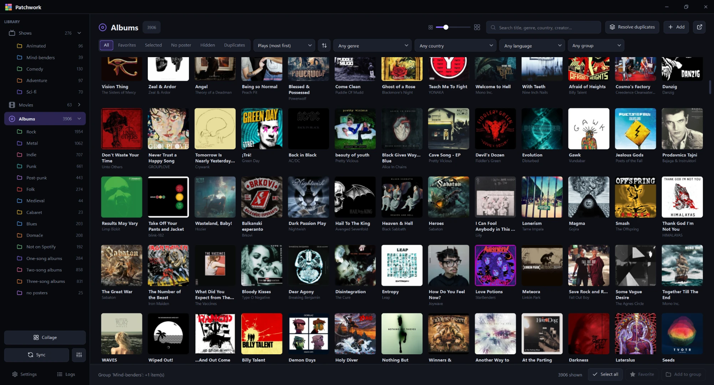
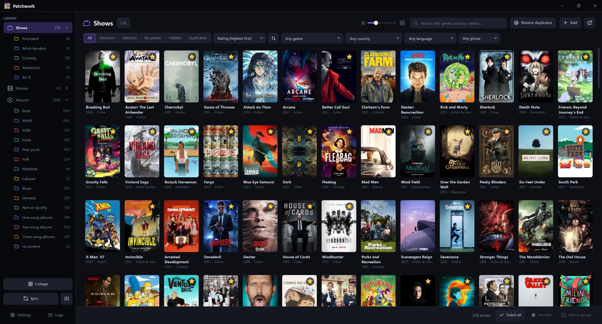
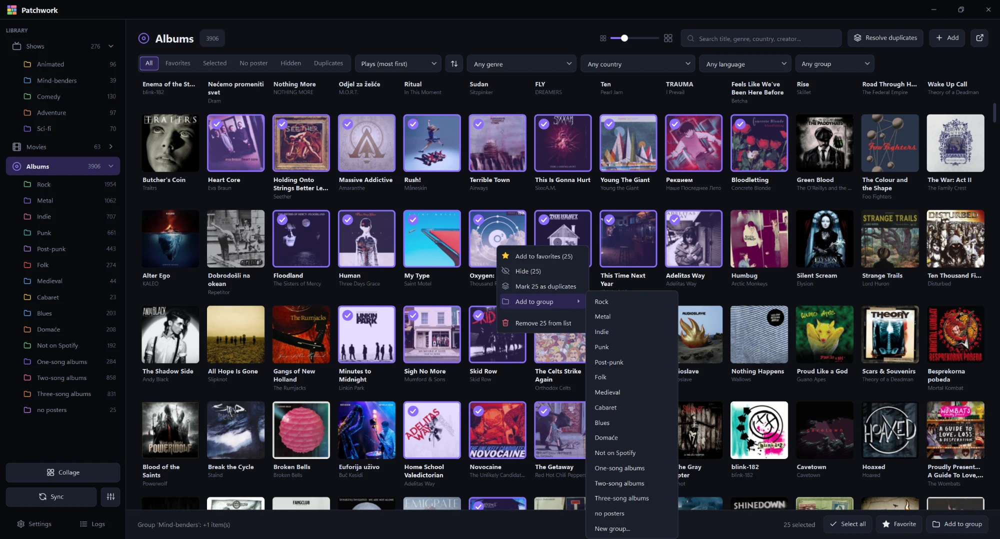
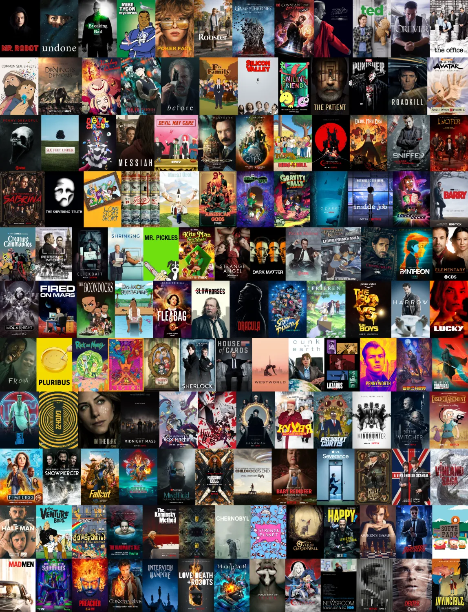
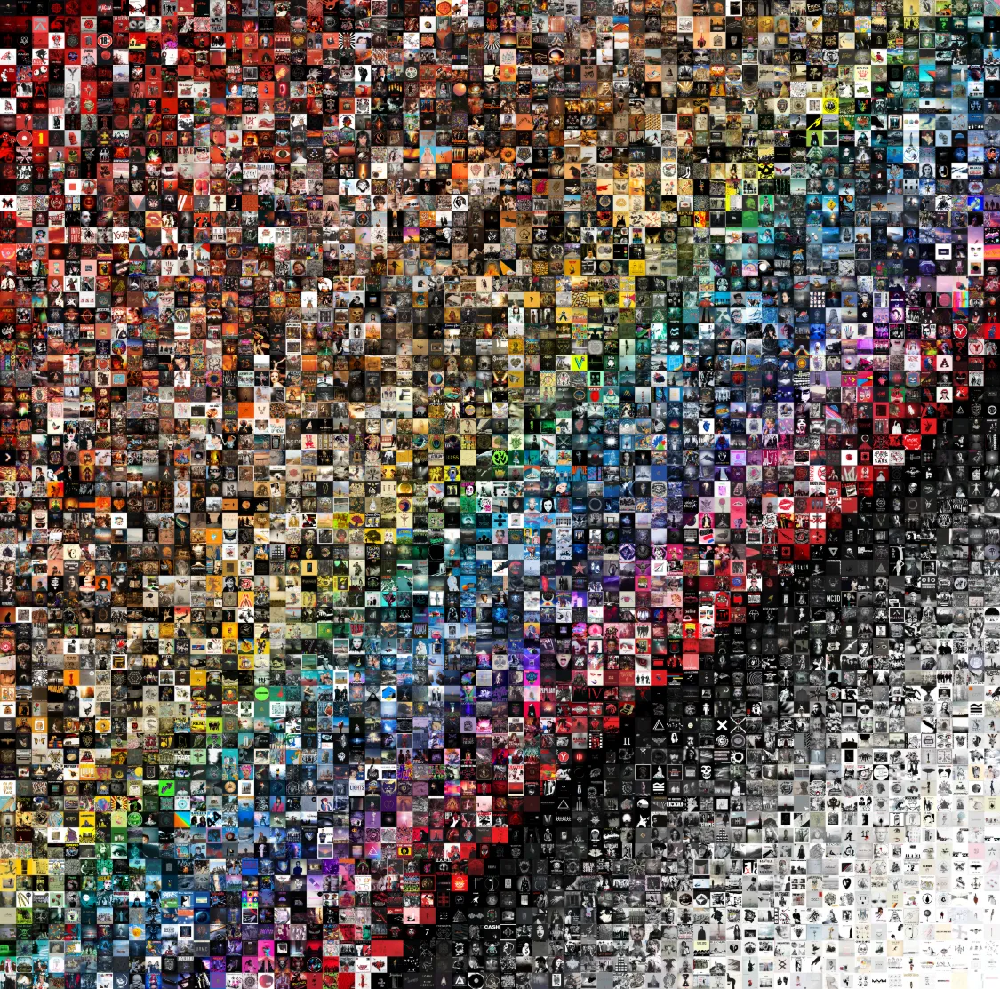
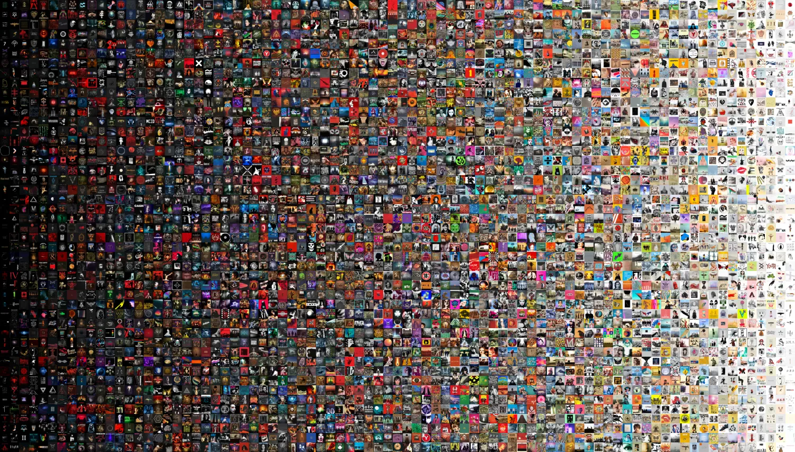
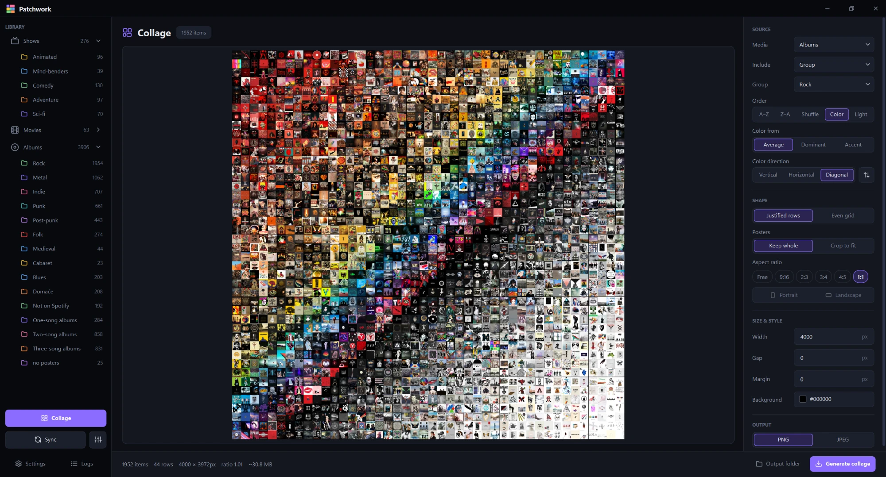
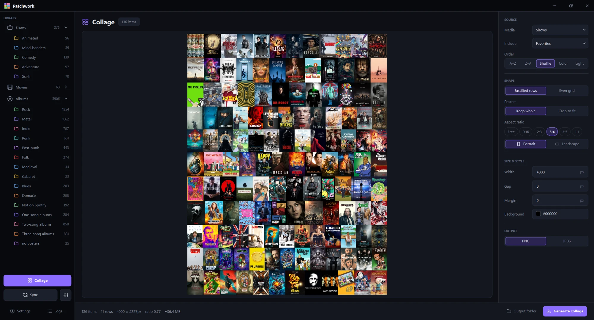

# Patchwork

A desktop app that collects the shows, movies and albums you watch and listen to, and turns them into poster collages.



## Overview

Patchwork pulls your libraries from the services where they already live, lets you organize and clean them up, and
renders the result as a poster collage. Everything is stored locally as plain JSON and image files.

It is written in Python with PySide6 (Qt) and also ships with a command-line interface.

## Features

- **Syncing.** Sonarr and Radarr for what you own, Trakt for what you have watched and rated, Last.fm and Spotify (your
  account, or a data export) for what you listen to. Posters and details come from those sources, with TMDB,
  MusicBrainz, Deezer and iTunes as fallbacks.
- **Browsing.** Shows, movies and albums each get their own library. Search, filter by genre, country, language or
  group, and sort by title, year, rating, plays, date added or cover color.
- **Organizing.** Favorites, custom groups (drag to reorder), renaming, hiding, a metadata editor, and a duplicate
  finder that catches editions of the same item by name, shared IDs and visually similar covers.
- **Collages.** Build from favorites, a group, a selection or everything. Justified rows or a fixed grid, any aspect
  ratio, ordered A-Z, shuffled or by color. The live preview re-renders at full detail as you zoom in.





## Collages

| Shows (favorites, shuffled) | Albums (sorted by color, diagonal) |
| --- | --- |
|  |  |



## Setup

Requires Python 3.10 or newer. It is developed and used on Windows.

```
pip install -r requirements.txt
python main.py
```

On Windows, `run.bat` starts the app without a console window.

Open **Settings** and enter the details for the services you use. None of them is required, and each has a *Test
connection* button. The same values can be placed in a `.env` file (see `.env.example`).

| Service | What you need |
| --- | --- |
| Sonarr / Radarr | address and API key |
| Trakt | a Client ID from your own Trakt app, and your public username |
| Last.fm | an API key and your username |
| TMDB | an API key, used for missing posters and details |
| Spotify | your own free Spotify app (see below). Sync then reads your saved albums and top songs (liked songs and playlists are optional), and the app also supplies album release years and missing covers |
| Spotify data export | no key; *Import from file* on the same page imports the data export (JSON files) you can request from your account. It is preferred for large playlists and saved libraries |

To set up Spotify:

1. Create a free app in the [Spotify developer dashboard](https://developer.spotify.com/dashboard).
2. Add `http://127.0.0.1:8765/callback` to the app's redirect URIs.
3. Paste its Client ID and secret on the **Spotify** page in Settings and press *Sign in*. Your browser opens to
   approve access.
4. Choose what to import from the account. Top songs are on by default.

API keys and the Spotify sign-in are stored in plain text in `.env` and `data/`, so keep those out of version control
and out of any folder you share.

Press **Sync** in the sidebar. The first run is slow, mostly because album genres, countries and release years come
from MusicBrainz at about one artist per second. Later syncs only fetch what is new. The button next to it opens the
sync options, where you can pick the sources, steps and media types.

## Usage

1. **Sync** to fill the libraries.
2. **Browse** the pages, star favorites and add items to groups. Right-click for rename, hide and remove.
3. **Clean up** with the *Resolve duplicates* button on each page.
4. Open **Collage**, choose a shape, size and order, then press *Generate collage*. The image is written to
   `data/output`.

| Albums | Shows |
| --- | --- |
|  |  |

Ctrl + scroll or Ctrl +/- changes the poster size, Ctrl+A selects everything shown and Ctrl+Z undoes a selection change.

Some defaults to be aware of: syncing only adds items and never removes them; Radarr only adds movies that are
unmonitored (configurable in Settings); and Trakt never changes your favorites unless you enable it.

## Building a standalone executable

`build.bat` packages the app with PyInstaller (it installs PyInstaller and the requirements first). The build is
described in `patchwork.spec` and produces two single-file executables:

```
build.bat
```

| File | Purpose |
| --- | --- |
| `dist\patchwork.exe` | the GUI, opens without a console window |
| `dist\patchwork-cli.exe` | the command-line interface (see below), a smaller console build without Qt |

Both keep their `.env` and `data/` folder next to themselves, so they can be moved around together or run from a USB
stick. When packaged, use `patchwork-cli.exe` in place of `python main.py` in the commands below.

## Command line

Syncing, importing and collages also work without the GUI. Without a command, `main.py` opens the app.

```
python main.py sync [sonarr|radarr|trakt|lastfm|spotify]
python main.py spotify-login
python main.py collage shows --favs --aspect 2:3 --width 4000
python main.py collage albums --order hue --direction diagonal
python main.py import-spotify YourLibrary.json --metadata
python main.py export backup.zip
python main.py import backup.zip
python main.py --help
```

## Data

Everything lives in `data/` next to the app, as plain files you can read and back up. `shows/` and `movies/` have the
same layout as `albums/`.

```
data/
  albums/
    library.json
    meta.json
    groups.json
    duplicates.json
    cover_colors.json
    cover_hashes.json
    posters/
  output/
  aliases.json
  ui.json
  spotify_auth.json
  crash.log
```

| Path | Contents |
| --- | --- |
| `library.json` | titles, favorites, and the hidden and removed ones |
| `meta.json` | per title: genres, countries, languages, creators, year, IDs, plays and your own edits |
| `groups.json` | your groups and the titles in them, in order |
| `duplicates.json` | duplicate sets you marked or rejected, and titles hidden as duplicates |
| `cover_colors.json`, `cover_hashes.json` | caches for color sorting and duplicate detection (albums) |
| `posters/` | one image per title |
| `output/` | generated collages |
| `aliases.json` | other spellings of a title, mapped to the one in your list |
| `ui.json` | window preferences, poster size and group colors |
| `spotify_auth.json` | your Spotify sign-in, never part of an export |
| `crash.log` | the traceback of the last crash |

**Settings -> Your data** exports all of it to a single file (API keys excluded) and imports it back.

## Project layout

```
src/core       library, metadata, groups, duplicates, storage
src/sources    one module per service, plus sync.py
src/collage    layout (row balancing) and rendering
src/gui        the Qt app
src/cli.py     the command line
tools          icon generation
docs           images used in this file
```

The poster grid is a custom-painted list view rather than thousands of widgets, which keeps the interface responsive
with libraries of tens of thousands of items. Most of that lives in `src/gui/media_page.py`.

## Troubleshooting

The **Logs** button in the sidebar shows what a sync or import did. If the application crashes, a traceback is written
to `data/crash.log`. Suggestions and bug reports are welcome.

## License

[TWAORPWB](LICENSE): thou wilt at own risk, praise with beer.
